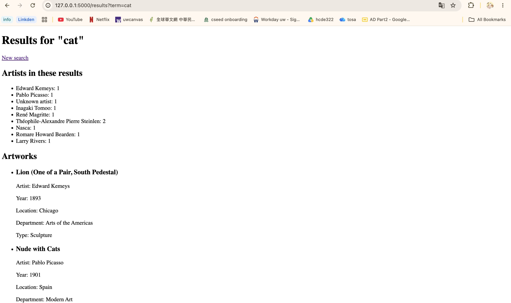

# HW4: Art Search

Students, art enthusiasts, and museum visitors who want to quickly search for artworks at the Art Institute of Chicago by entering an artist's name or a subject and explore artwork details and artist summaries.

## How to run it
In the `hw4` folder, with your venv on:

    pip install flask requests
    flask --app app run --debug

Then open http://127.0.0.1:5000. Ctrl+C stops it.

## Screenshot
