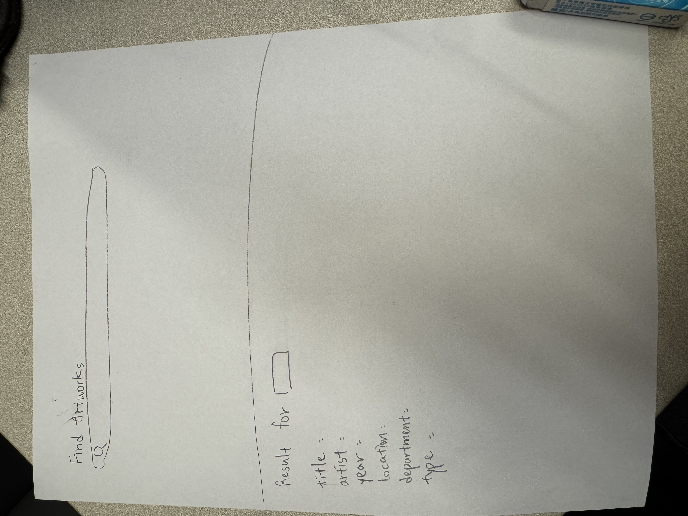

## 1. Sketch the screens
.

Searching page: I have a big title "Find Artworks" and a search bar under it, it is a big search bar as well. This is simple and I want users to search the thing they want directly.

Result page: It will have a big title "Results for ____" with the word they typed, then for each artwork: title, artist, year, location, department, type.

## 2. Write down the data

I looked at my sample_response.json in hw3, I think all the things I need are inside data["data"], which is a list of artworks (dictionaries).

For each artwork I need: title (artwork title), artist_title (artist name), date_display (date), place_of_origin (location), department_title (department), artwork_type_title (type). They can all be missing, and if they're missing it will show "Unknown ____" for that category.

These are the same fields I printed in HW3, so I can reuse my loop.

## 3. Spec each piece

### A. search_art(term) in api.py
- In: the search word (string), like "cat"
- Out: a list of artworks (can be empty), or None if the API call failed
- Checks:
  1. Search "cat" → I see artworks on the page (pass)
  2. Search "12345678901234" → empty list, so I see the "No results found" message, not a crash(pass)
  3. Break the URL on purpose → search_art gives back None, the terminal prints the status code, and the page shows an error message(pass)

### B. clean_artworks(artworks) in api.py
- In: the raw list from data["data"]
- Out: a list of dictionaries with only my 6 fields, and no None ("Unknown ____" instead)
- Checks:
  1. Search "cat" and the Baroque Pearl cat (no artist) shows "Unknown artist", not None(pass)
  2. Nothing on the results page says "None"(pass)
  3. With the fake data, the second artwork shows "Unknown location" and "Unknown type"(pass)

### C. count_by_artist(artworks) in api.py (from my HW3)
- In: the cleaned list of artworks
- Out: a dictionary like {"Pablo Picasso": 2, "Unknown artist": 1}
- Checks:
  1. Search "cat" → the "Artists in these results" list shows up with numbers(pass)
  2. The Baroque Pearl cat counts as "Unknown artist", not None(pass)
  3. The counts add up to the number of artworks on the page(pass)

### D. "/" route + home.html
- In: nothing (or a message when the user gets sent back)
- Out: the search page with a labeled input and a button
- Checks:
  1. Open http://127.0.0.1:5000 and I see "Find Artworks" and the search box(pass)
  2. When there's a message (like empty input), it shows above the form(pass)

### E. "/results" route + results.html
- In: "term" from the form (request.args)
- Out: the results page, or the home page with a helpful message
- Checks:
  1. Search "cat" and "Results for cat", the artist counts, and the artworks with all 6 fields(pass)
  2. Submit an empty form (or just spaces) → back home with "Please type something to search for"(pass)
  3. Search "123456789" and home page with "No results found for "123456789". Please try some other term."(pass)

